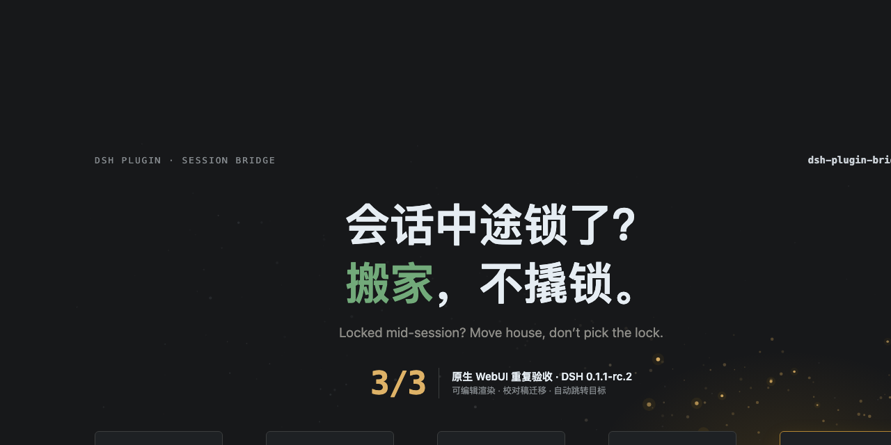

# dsh-plugin-bridge

<p align="center">
  
</p>

[](https://github.com/deepseek-ai/deepseek-harness)
[](https://www.npmjs.com/package/dsh-plugin-bridge)
[](#discover)
[](https://github.com/Totoro-qaq/dsh-plugin-bridge/actions/workflows/ci.yml)
[](LICENSE)
[](package.json)
[](docs/compatibility/dsh-0.2.1-rc.2-entrypoints-2026-10-18.md)
[](https://github.com/awesome-dsh-plugin/awesome-dsh-plugin)

[English](README.md) | 中文

在 Web preset 做到一半，想换 Code preset 继续？直接切换会让旧工具组的调用历史留在新组合里。Bridge 先生成一份有界、可编辑的五段交接，再建立干净目标会话；原会话始终不动。

<p align="center">
  
</p>

[快速开始](#快速开始) · [为什么是-bridge](#为什么是-bridge) · [实测证据](#实测证据) · [迁移决策](#迁移决策) · [兼容性](#兼容性)

## 快速开始

Bridge **0.5.0** 新增会话菜单、可配置快捷键和自然语言入口，保留预览、编辑和人工确认。候选包已通过官方 **0.2.1-rc.2 Web 与原生 macOS 桌面端**的隔离迁移验收，以及 **0.2.0-rc.2** 无密钥旧宿主回归。[验收记录](docs/compatibility/dsh-0.2.1-rc.2-entrypoints-2026-10-18.md)区分了实测、限制和待完成的发布核验。**0.4.7** 引入的 **0.2.1** 有界准入策略保持不变；能安装不等于已实测，详见[兼容策略](#兼容策略)。

安装或卸载包时，请核对**宿主实际调用的 pnpm 可执行文件**。pnpm 11.22.0 存在已知的 late-worker 退出缺陷，可能在输出 Done 后仍不结束；自然 DSH 对照已隔离上游修复。建议使用包含[上游修复](https://github.com/pnpm/pnpm/releases/tag/v11.26.0)的 **11.26.0 或更新版本**，不要重叠包操作。存在未结束操作时，先等待其完成，或正常停止宿主后再使用离线 CLI。Bridge 不附带 pnpm，也不会自动升级你的工具。

### npm / CLI

从 npm 安装：

```bash
dsh plugin --profile web add dsh-plugin-bridge
```

在 **DSH 0.1.5-rc.2** 上，添加或移除插件后需要重启 `dsh web`。在 **DSH 0.1.6-alpha.2** 上，从 WebUI「插件」页首次安装可以直接生效；CLI 安装或升级已有插件仍可能需要一次重启。**DSH 0.1.7-alpha.1** 已验收 CLI 安装、实时停用/启用及卸载后重启；未验证免重启安装或升级。

在启用 HMR 的 **DSH 0.2.1-alpha.3 / 0.2.1-alpha.4 Web** 中，运行中的 `pluginManager` 服务通过 `installBundle()` API（包括 Remote API 调用方和 agent 的 `plugin_manager` 工具）安装 profile 中已有的包时，会返回 `already-installed`，指定另一版本也一样。API 替换顺序是 `removeBundle(name)`、`installBundle(spec)`，并遵循宿主的重启提示，详见[上游升级说明](https://github.com/deepseek-ai/deepseek-harness/blob/dsh-v0.2.1-alpha.4/docs/upgrade-guide/v0.2.1-alpha.2/plugin-install-over-installed/guide.zh.md)。

CLI 替换时，先停止使用目标 profile 的宿主，再执行 `dsh plugin --profile web remove dsh-plugin-bridge`、`dsh plugin --profile web add <目标包 spec>`，最后重新启动宿主。[CLI 独立执行 profile 包操作](https://github.com/deepseek-ai/deepseek-harness/blob/dsh-v0.2.1-alpha.3/apps/cli/src/plugin.ts)，不经过上述运行中 API 的重复安装拒绝路径。

两种替换方式都应先完成或保存尚未确认的交接：预览和编辑稿保存在内存中，停止或卸载 Bridge 会清除确认状态。原会话仍然保留；重新安装后生成新预览，再贴回保存的草稿。这些 Web 操作不会升级原生桌面端；原生桌面 **0.2.1-rc.2** 的验收[单独记录](docs/compatibility/dsh-0.2.1-rc.2-entrypoints-2026-10-18.md#native-macos-desktop-acceptance)。

GitHub 固定版本备用路径：

```bash
dsh plugin --profile web add github:Totoro-qaq/dsh-plugin-bridge#v0.5.0
```

### Discover

提供 Discover 的 DSH（**0.2.1-alpha.4** 引入）也可以通过作者的索引安装 Bridge：

1. 打开 **插件 → 实验性插件 → 更多**，启用 **自定义插件市场**。
2. 进入 **发现（Discover）→ 添加索引源**，粘贴：

   ```text
   https://raw.githubusercontent.com/Totoro-qaq/dsh-plugin-index/main/index.json
   ```

3. 选择 **Bridge 会话交接**，在确认框核对包名、版本及 `https://registry.npmjs.org/`，安装后点 **立即启用**。

这是[作者自托管的第三方源](https://github.com/Totoro-qaq/dsh-plugin-index)，不代表官方认证或社区审核；需要在想使用的 profile 中手动添加。公开地址的添加、安装已在[隔离 alpha.4 WebUI 中验收](https://github.com/Totoro-qaq/dsh-plugin-index/blob/main/docs/acceptance-2026-10-16.md)；原生桌面端本轮未单独重测 Discover 安装路径。没有 Discover 的客户端继续使用上面的 npm/CLI 方式即可。

### 三种入口

- **菜单按钮**：打开侧栏中当前会话的 `⋯` 菜单，选择「迁移会话」，不替换草稿、不提交待发送附件。输入框为空时也可使用 `+` 菜单里的 Bridge 项；已有草稿时，DSH 会在该菜单中隐藏带参数的命令。不会新增常驻标题栏按钮或第二条命令。
- **快捷键**：在 DSH 快捷键设置里搜索「Bridge」，为「Bridge：迁移会话」绑定按键。默认未绑定，不占用系统、宿主或其他插件的组合键；命令 ID 是 `dsh-plugin-bridge.open`。
- **自然语言**：例如「把当前任务交接到 PTC，先让我看看摘要」。支持模型工具的模式可以调用 `bridge_prepare`；目标不明确时先显示模式选择。模型只能准备交接，不能代替你确认迁移。

三种入口都保留**人工确认**：选择目标 → 生成预览 → 文本/Markdown 编辑 → 点击确认。原来的 `/bridge` 命令继续可用。缺少相应界面或工具接口的宿主保留命令回退；快捷键仅在当前会话页面生效，不会在随记等独立页面或模态框中触发。

自然语言入口默认开启，可在 Bridge 配置中设置 `naturalLanguage: false` 关闭；按钮、快捷键和原命令不受影响。开启时会增加少量工具描述 token，不再承诺所有普通请求均零开销。详见[入口、生命周期和确认边界](docs/entrypoints.md)。

### 原有命令

然后在官方 WebUI 输入：

```text
/bridge                       列出目标 preset
/bridge --doctor              DSH 升级后检查 host 契约
/bridge code                  只预览交接，什么都不改
/bridge code --go             迁移、复述，然后等待
/bridge code --go --continue  在同一次目标请求里复述并开始工作
```

DSH rc.7 及以上会在官方 WebUI 原生卡片中渲染 `/bridge`。「文本编辑」把固定五段变成普通文本框，并无损支持平坦的项目符号或编号列表；「Markdown」保留完整源码自由；「预览」渲染 Markdown 或完整 JSON 树。长内容只在卡片正文内滚动；点「确认迁移」后自动打开目标会话。Bridge 0.3.10 在已测的窄窗口中为固定输入栏留出了确认按钮的可点击空间。

实现官方 `conversation.chat.commandview` slot 的第三方 UI 会自动得到同一张卡片。其他自定义 UI 仍保留完整服务端结果、摘要文件流程和目标标题/session ID 回退；UI 作者还可以复用无 React 的 `dsh-plugin-bridge/client-contract` 导出，而无需重写协议。旧客户端可修改输出里打印的摘要文件，再执行：

```text
/bridge code --go --file <路径>
```

预览中的修改在确认迁移前只是临时草稿。重启客户端或系统可能使其丢失；源会话始终不受影响，重新运行预览即可生成新的草稿。

卸载：`dsh plugin --profile web remove dsh-plugin-bridge`，然后重启 `dsh web`。

## 为什么是 Bridge

| 承诺 | 具体含义 |
|---|---|
| **执行前预览** | `/bridge <preset>` 不创建目标、不改源会话；先检查或修改固定五段交接。 |
| **迁状态，不迁工具痕迹** | 决策、路径、当前状态和下一步进入干净 preset；旧工具组的不兼容调用不会跟过去。 |
| **失败时关闭迁移** | kickoff 前暂停目标；无法保证时清除/取消目标，不发送模型请求。 |

关闭自然语言入口（`naturalLanguage: false`）时，按钮、快捷键和 `/bridge` 都由宿主直接派发，不向模型增加 Bridge 工具描述。默认开启自然语言入口时会注册一个仅准备预览的工具；生成摘要仍只在你发起交接时调用压缩工人。

## 实测证据

这是小样本、可复现的回归门禁，不是总体准确率保证。

| Gate | 结果 |
|---|---:|
| 五段摘要事实 | **30/30** |
| 目标复述 / 首次有效工作事实 | **60/60 · 60/60** |
| 关键事实 / 旧值复活 | **90/90 · 0** |
| 已有图片证据 / 未解析原图路径 | **5/5 · 5/5** |
| Confirm / `--continue` 到首次有效工作的目标请求数 | **2 · 1** |
| Confirm 相对 `--continue` 的 nominal 配对中位额外成本 | **+8.1%** |
| 摘要 worker 在干净验收组件中的 nominal 占比 | **20.74%** |
| 原生 WebUI 重复门禁（预览 / 目标事实） | **3/3 · 3/3**，每次五项 |
| DSH 0.1.2 alpha.2 / alpha.3 / alpha.5 官方 WebUI 实装 | **13/13 · 编号列表编辑 · PTC 已暂停 · 图片转文本降级** |
| DSH 0.1.5-rc.1 官方 WebUI 实装，npm Bridge 0.3.4 | **13/13 · 3/3 次迁移 · 编辑逐字送达 · PTC 已暂停 · 原图直达视觉目标** |

token 百分比会随 preset、回复长度和缓存状态大幅波动；worker 占比是组成，不是相对“无 Bridge”的因果开销。稳定结论是默认确认多一个请求。边界和原始证据见[设计与证据说明](docs/design.md)、[完整 release report](reports/v0.2.3-e2e-report.md)和[视觉迁移报告](reports/v0.2.6-rc11-vision-report.md)。

## 工作原理

```text
折叠历史 -> 五段交接 -> 预览/编辑 -> 干净目标会话
         -> 暂停存储目标 -> 注入 -> 复述 -> 等待或同轮继续
图片历史 -> 原样搬运助手证据；未解析原图走附件网关
```

五段分别是：目标、当前状态、关键决策与约定、关键文件、下一步。原会话不会被改写；接得不好时归档目标，直接回源会话。

## 迁移决策

| 场景 | Bridge 行为 | 成本 / 保真影响 |
|---|---|---|
| `naturalLanguage: false`，未发起交接 | 不注入提示，不注册模型工具 | **0 Bridge prompt token** |
| 自然语言入口开启，未发起交接 | 注册 `bridge_prepare` 的工具描述 | 有工具描述开销；无摘要工人请求 |
| `/bridge code` | 起一个有界摘要 worker，只输出预览 | 不创建目标会话 |
| 默认 `--go` | 目标先复述再等待 | 首次有效工作前多一个显式确认请求 |
| `--go --continue` | 确认既定下一步，同一次目标请求里复述并开工 | 单独审批和安全限制仍生效，没有后台 goal 轮次 |
| 图片已有助手分析 | 逐字搬运对应回答 | 默认不重发原图 |
| 图片未解析，目标可接图 | 搬原附件并保留源 VLM | 视觉费用由所选 provider 计算 |
| 图片未解析，目标是纯文本模型 | prompt 准入拒图，Bridge 显式发送文字降级 | 不暗启本地 VLM，也不假装看懂图片 |

## 兼容性

### 兼容策略

Bridge **0.4.7** 起，`engines.dsh` 表示安装准入范围，不再充当逐个版本的实测名单：

```text
>=0.1.0-rc.7 <0.2.0-0 || 0.2.0-rc.2 || >=0.2.1-alpha.1 <0.2.2-0
```

旧宿主范围不变。0.2.1 范围允许后续 alpha、beta、rc 和 0.2.1 正式版，但不放行 0.2.2 预发布版及更高版本。DSH 使用 `includePrerelease: true` 评估该字段，显式的 `<0.2.2-0` 上限可避免 caret 顺带放行后续 0.2.x 预发布版。

准入不等于验收：下表、逐版本报告和 Workshop 的精确 `dshVersions` 只列实际测过的宿主。已发布的包元数据是快照，后来补充文档不会悄悄改写旧 npm 包。后续兼容的 0.2.1 更新仍需差异检查和短测，但不必只为追加一个 alpha 编号重新发 npm；确有代码、依赖或打包修复时才发新版，跨系列则先审查范围边界。开发 SDK 保持已经验证的 alpha.4 精确版本，不必跟每个兼容宿主同步升级。`/bridge --doctor` 可指出缺少的能力，但不能代替真实迁移验收。

Bridge **0.4.0** 起在官方计划评审卡上提供 **“批准并在新会话执行”**，现已在 DSH **0.2.0-rc.2** 和 **0.2.1-alpha.1** WebUI 验证。用 `/plan` 规划，模型通过 `exit_plan_mode` 呈交完整计划后，点击该按钮：原规划轮次停止，原会话保留计划模式；新会话沿用当前工具模式、模型和工作目录，首轮提示逐字接收批准的计划并开始实施。原有“同意执行”和“要求修改”仍按宿主原来的方式工作。详见[计划批准交接说明](docs/approved-plan-handoff.md)。

已发布 Bridge **0.4.1** 另通过[原生 macOS Desktop 0.2.0-rc.2 验收](docs/compatibility/desktop-0.2.0-rc.2-2026-10-05.zh-CN.md)：安装、编辑迁移、批准计划执行、实时启停、卸载和重启。桌面与 npm WebUI 记录分开；不认证原生窗口像素或账号登录。

**0.5.0 候选包**另通过[原生 macOS Desktop 0.2.1-rc.2 验收](docs/compatibility/dsh-0.2.1-rc.2-entrypoints-2026-10-18.md#native-macos-desktop-acceptance)：GUI 安装、快捷键绑定与改绑、会话菜单、真实自然语言预览、编辑稿逐字交接、自动打开目标、正常退出、重启与 GUI 卸载。本轮不重新认证计划批准执行、原生中文输入法/粘贴集成、账号登录或所有第三方 UI/插件组合。

| DSH 基线 | 服务端交接 | 原生卡片 | 验证边界 |
|---|---:|---:|---|
| 0.2.1-rc.2 | 支持（Bridge 0.5.0 候选包） | Web 与原生 macOS 桌面端通过 | 官方隔离 Web 与桌面端，doctor 13/13；会话菜单、可配置快捷键、真实自然语言预览；文本/Markdown 编辑后显式确认迁入 PTC，goal 暂停且限制一轮。Web 另测生成中卸载、邻近插件共存与卸载重启；桌面端正常退出、重启及 GUI 卸载通过。原生端 1,519 字符逐字交接与限制见[候选验收记录](docs/compatibility/dsh-0.2.1-rc.2-entrypoints-2026-10-18.md)。本地候选验收不等于 npm 已发布，也不代表重测了每个可选功能。 |
| 0.2.1-alpha.5 | 支持（Bridge 0.4.7） | 真实编辑、确认和自动打开通过 | 官方 npm 宿主，无兼容豁免、doctor 13/13；一次预览工人，1,856 字符界面审阅稿逐字迁入 PTC，goal 暂停，目标一轮且无工具。文本/Markdown 往返、编辑框滚动、确认时目录、启停、重启、卸载和 CLI shim 清除均通过。见[限定范围验收](docs/compatibility/dsh-0.2.1-alpha.5-2026-10-17.md)；后续版本获准安装不等于已实测。 |
| 0.1.0-rc.6 | 支持 | 不支持 | 窄 RPC 契约与文本兼容测试 |
| 0.1.0-rc.7 / rc.8 | 支持 | 契约核对 | client module / command slot 契约与服务端回退 |
| 0.1.1-rc.2 | 支持 | 支持 | 官方 WebUI 实装：doctor 13/13、编辑/确认/自动跳转、三次重复门禁 |
| 0.1.2-alpha.2 / alpha.3 / alpha.5 | 支持 | 支持 | 官方 DSH npm 宿主：typed controllers 13/13 与 PTC 自动跳转；alpha.5 门禁安装分支 tarball，保留 alpha.3 标题，编号列表可编辑，未解析图片降级为文本，卸载干净 |
| 0.1.2-rc.1 → 0.1.3-alpha.2 | 支持（Bridge 0.3.3+） | 支持（Bridge 0.3.3+） | 官方 npm 宿主真实升级、v2 历史与标题保留、编辑内容逐字交接、PTC goal 暂停、图片回退及卸载；见[验收记录](reports/dsh-0.1.3-alpha.2-compat-2026-09-08.md) |
| 0.1.5-alpha.1 | 支持（Bridge 0.3.4+） | 支持（Bridge 0.3.4+） | 官方 npm 宿主（会话格式 V3）：tarball 安装、原生卡片 bundle 已下发、V3 会话上 doctor 13/13 与预设列表；SDK 类型 diff 与 V3 折叠 fixture。未重跑需要模型的预览、迁移与图片回退；见[smoke 记录](reports/dsh-0.1.5-alpha.1-compat-2026-09-09.md) |
| 0.1.5-rc.1 | 支持（Bridge 0.3.4+） | 支持（Bridge 0.3.4+） | 官方 npm 宿主，已发布的 0.3.4 未改动：doctor 13/13，原生卡片实际渲染，三次真实模型迁移到 PTC，编辑内容逐字交接且 goal 保持暂停，未解析图片以原图交给支持图片的默认模型；见[验收记录](reports/dsh-0.1.5-rc.1-compat-2026-09-10.md) |
| 0.1.6-alpha.1 | 支持（Bridge 0.3.6+） | 支持（Bridge 0.3.6+） | 官方 npm 宿主：doctor 13/13，原生卡片实际渲染，PTC 运行时改名后 `ptc` 仍可迁入，未配置 key 时预览按设计失败退出；SDK 变化只有新增，`lib/` 与 0.3.5 逐字节相同。未重跑真实模型迁移；见[smoke 记录](reports/dsh-0.1.6-alpha.1-compat-2026-09-15.md) |
| 0.1.6-alpha.2 | 支持（Bridge 0.3.7+） | 支持（Bridge 0.3.7+） | 官方 npm 宿主：Bridge 0.3.6 能完成迁移，但「打开目标会话」按钮报 `ctx.sessions.open is not a function`；Bridge 0.3.7 在 alpha.2 和 alpha.1 上都通过 `uiWorkspace.openSession` 打开目标，goal 保持暂停，在插件页实时停用和启用也正常；见[验收记录](reports/dsh-0.1.6-alpha.2-compat-2026-09-18.md) |
| 0.1.7-alpha.1 | 支持（实测 Bridge 0.3.9） | 支持（实测 Bridge 0.3.9） | 已发布包未改动：13 个 V3 会话恢复为 V4、12 个标题保留、doctor 13/13、真实模型编辑与两种迁移模式、自动跳转、暂停 goal、worker 清理、图片转文本回退及实时启停。卸载清除包/命令/CSS，但留下失效 CLI 链接；见[验收记录](reports/dsh-0.1.7-alpha.1-compat-2026-09-22.md)。 |
| 0.1.7-alpha.2 | 支持（Bridge 0.3.10 源码） | 支持（Bridge 0.3.10 源码） | 官方 npm 宿主 + 本地打包的 Bridge 源码：doctor 13/13、真实模型预览、文本/Markdown 往返、640/800 像素宽窗口确认按钮可达、编辑稿逐字交接、目标无工具调用、自动跳转且 goal 暂停。这里是源码验收，不等于已完成 npm 包安装验收；见[限定范围验收](reports/dsh-0.1.7-alpha.2-compat-2026-09-23.md)。 |
| 0.1.7-rc.1 | 支持（Bridge 0.3.10） | 支持（Bridge 0.3.10） | 官方 npm 宿主隔离验收：全新 profile 安装；已有会话上 WebUI 启动、doctor 13/13；一次真实模型文本/Markdown 编辑并迁入 `ptc`，编辑稿逐字交接、自动跳转、goal 暂停、目标无工具调用、源会话不变；640/800 像素宽确认按钮可点击。卸载重启通过，但仍留下失效 CLI 链接。测试宿主因 registry 问题跳过可选办公组件；见[验收边界](docs/compatibility/dsh-0.1.7-rc.1-2026-09-24.md)。 |
| 0.2.0-rc.2 | 支持（实测 Bridge 0.3.10；0.3.11 补声明） | 支持（运行代码相同） | 官方 npm WebUI 隔离验收：doctor 13/13、真实预览与文本/Markdown 编辑、编辑稿逐字交接、直接继续和等待确认、自动跳转、暂停 goal、原图传递/文本回退、实时启停及卸载重启。仍留失效 CLI 链接；未覆盖全量可选组件和原生桌面端，见[限定范围验收](docs/compatibility/dsh-0.2.0-rc.2-2026-09-30.md)。 |
| 0.2.1-alpha.1 | 支持（Bridge 0.4.1 补声明） | 支持（0.4.0 运行代码不变） | 已发布的 0.4.0 在官方 npm WebUI 隔离实测：doctor 13/13、渲染编辑、484 字符编辑稿逐字迁入 PTC、自动跳转和暂停 goal；真实点击计划批准后在新 standard 会话写入并读回精确 18 字节文件。启停保留其他样式；卸载重启后包和命令移除，但仍留失效 CLI 链接。见[限定范围验收](docs/compatibility/dsh-0.2.1-alpha.1-2026-10-04.md)。 |
| 0.2.1-alpha.2 | 支持（Bridge 0.4.2） | 支持（Bridge 0.4.2） | 官方 npm WebUI：预览、确认和计划批准时重读当前目录，真实工人启动、文本/Markdown 切换、2,009 字符编辑稿逐字迁入 PTC、自动打开和暂停 goal；批准的完整计划在切换后的目录写入、读回并核对文件字节。已检查与 Jot 共装、实时启停、卸载和重启，见[限定范围验收](docs/compatibility/dsh-0.2.1-alpha.2-2026-10-10.md)。 |
| 0.2.1-alpha.3 | 支持（Bridge 0.4.5 补声明） | 支持（运行代码相同） | 官方 npm WebUI 实测使用业务 `lib/` 逐字节相同的本地 0.4.4 候选包：工人在目录 A 用时 37 秒，确认时重读目录 B，2,669 字符编辑稿仅交接一次、自动打开、goal 暂停、目标无工具；375/768/1280 像素控制、实时启停、相同业务字节卸载重装和同 Home 重启通过。首个混合格式摘要触发 Text → Markdown 回退，测试者显式改格式后才完成 Text 往返。见[限定范围记录与发版映射](docs/compatibility/dsh-0.2.1-alpha.3-2026-10-15.md)；历史候选验收不能代替 0.4.5 的 registry 安装验证。 |
| 0.2.1-alpha.4 | 支持（Bridge 0.4.6） | 预览、文本/Markdown 编辑和自动打开通过 | 官方 npm 宿主实装本地 0.4.6 包：工人 27 秒，2,883 字符编辑稿精确迁入、goal 暂停，目标一轮且无工具；375/768/1280 像素控制、保留其他样式的启停和限定范围重启恢复通过。自然同包图 DSH 卸载对照隔离了 pnpm 11.22.0 的 late-worker 缺陷；上游单补丁对照及未修改的 11.26.0 均完成卸载。历史操作仍不算 PASS，见[验收与归因边界](docs/compatibility/dsh-0.2.1-alpha.4-2026-10-16.md)。 |

Bridge 0.4.2 在 `engines.dsh` 中追加精确的 `0.2.1-alpha.2`，并修复“迁回旧目录”和“尾部历史裁掉启动事件后误报工人未启动”两处运行问题；已发布的 0.4.1 不含这次修复。rc.2 桌面和 alpha.1 的回归短测与 alpha.2 Web 验收分开记录。

历史版本说明：Bridge **0.4.6** 当时只在现有宿主范围中追加精确的 `0.2.1-alpha.4`，并以对应 SDK 和 Cordis `4.0.5-alpha.2` 构建。Bridge 0.4.5 较窄的 engine 不满足 alpha.4 的安装规则；当次未用兼容豁免。业务源码和生成的 `lib/` 未变，官方 0.2.0-rc.2 和 alpha.3 Web 宿主的无密钥启动、doctor、client 资源和卸载短测也通过。alpha.4 核心工作流及修复版包管理器卸载对照通过，早先失败的操作仍保留在记录中；本地检查、限定范围实测和 release、tag、npm 发布是不同门禁。后续预发布版和 0.2 正式版不在当时 0.4.6 的声明中，0.4.7 起按上面的有界范围执行。不同业务字节的热替换未测，因此 Workshop 激活方式仍为 `restart-host`，热重载证据保留为空。当次未重新认证计划批准后的真实执行、图片传递、原生 alpha.4 桌面端、Windows 或 Linux。

DSH 0.1.5-alpha.1 请使用 Bridge 0.3.4 或更高版本：DSH 没有发布 0.1.4，而 `^0.1.3-alpha.2` 这类 caret 预发布范围不会匹配下一个预发布 minor，所以 0.3.4 追加 `^0.1.5-alpha.1` 并基于该 SDK 构建，`lib/` 产物逐字节相同。会话格式 V3 把系统提示词记成 `system/message` surface node；Bridge 只折叠用户、助手和工具事件，提示词文本不会进入交接。DSH 0.1.3-alpha.2 请使用 Bridge 0.3.3 或更高版本；Bridge 0.3.2 不包含那些兼容改动。typed adapter 只调用一次 `inspect`，就能读取默认 240 条消息的历史窗口，原来需要四次；不会缓存运行状态。`doctor` 检查方法是否存在，不能代替完整迁移验收。 同一个 `^0.1.5-alpha.1` 范围也覆盖 0.1.5-rc.1 和之后的 0.1.5 正式版，所以 rc.1 不需要新发 Bridge。

0.3.5 起压缩工人默认跟随会话当前模型（`modelTier: current`）。在 DSH 0.1.5-rc.1 上这就是 V4.1-Flash，它在[档位对比](reports/worker-tier-rc1-2026-09-10.md)里与 V4-Pro 打平，摘要用时约减半。DSH 0.1.5-rc.1 之前的版本没有 V4.1-Flash，请设 `DSH_BRIDGE_TIER=pro` 或用 `--tier pro`。

DSH 0.1.6-alpha.1 请使用 Bridge 0.3.6 或更高版本（只改了依赖范围，发布代码与 0.3.5 相同）。

0.3.8 起五个 DSH 可选 peer 范围改为 `"*"`，由 `engines.dsh` 表达宿主支持声明。Bridge 0.4.1 声明 `>=0.1.0-rc.7 <0.2.0-0 || 0.2.0-rc.2 || 0.2.1-alpha.1`：保留原范围，只追加本次验收的 alpha.1，不提前承诺后续 0.2 预发布版或 0.2.0/0.2.1 正式版。dshmarket 以 `includePrerelease: true` 评估此字段；官方 0.2.0-rc.2 安装器检查的是 DSH peer 范围，因此“能安装”不等于“已经验收支持”。

DSH 0.1.6-alpha.2 删除了客户端的 `sessions.open`。Bridge 0.3.6 在上面仍能完成迁移，但「打开目标会话」按钮会报 `ctx.sessions.open is not a function`。请使用 Bridge 0.3.7 或更高版本，它改为通过 WebUI 导航服务 `uiWorkspace.openSession` 打开目标，旧宿主上回退到 `sessions.open`。

CI 覆盖 Node.js 22/24。每次升级 Harness 后先跑 `/bridge --doctor`；缺哪个必要网关方法会被直接点名。

DSH 0.1.7-alpha.1 使用已发布的 Bridge 0.3.9，在 macOS / Node 22.23.1 上完成验收，没有改运行时代码或依赖。V3→V4 测试使用已有测试 home 的副本；升级前请备份 `DSH_HOME`，包括会话和 profiles，不要只备份插件目录。旧自定义目录 preset 的迁移、其他 UI/插件组合及 Windows 不在本轮范围内。本次兼容验收不需要另发 Bridge npm。

Bridge 0.3.10 包含在 DSH 0.1.7-alpha.2 上验收的源码修复：压缩工人漏写时，将窄范围内识别出的、仍然生效的用户“禁用工具／禁止读写文件”明文约束补进可编辑交接稿；小窗口中确认按钮不再被固定输入栏遮挡。用户后来明确放开限制时，旧限制不再补入。这不是“所有用户约束都能自动保真”的承诺，确认前仍应过目并编辑；最终按编辑稿逐字交接。所链验收记录发生在 npm 发布之前，不应视为已发布包的安装验收。

已发布的 Bridge 0.3.10 还通过了 DSH 0.1.7-rc.1 的限定范围兼容验收，无需改 Bridge 运行时代码或重发 npm。这**不是**对 DSH 所有可选依赖和第三方 UI 的验收；具体范围见[rc.1 记录](docs/compatibility/dsh-0.1.7-rc.1-2026-09-24.md)，升级自己的宿主后仍应运行 `/bridge --doctor`。

针对 DSH **0.2.0-rc.2**，Bridge **0.3.11** 仅更新支持元数据和文档，迁移运行代码与实测的已发布 0.3.10 相同。[验收记录](docs/compatibility/dsh-0.2.0-rc.2-2026-09-30.md)区分了真实模型/WebUI 测试和打包检查；不代表 DSH 0.2.0 正式版、原生桌面端登录/退出、所有可选组件或第三方 UI 已经通过验收。

针对 DSH **0.2.1-alpha.1**，Bridge **0.4.1** 更新支持声明和文档，服务端/客户端源码、已提交的 `lib/`、SDK 基线及依赖均与 0.4.0 相同。[验收记录](docs/compatibility/dsh-0.2.1-alpha.1-2026-10-04.md)记录真实模型流程和插件生命周期。本轮未重新认证图片传递/回退、原生桌面端、后续 alpha 或任意第三方 UI/插件组合。

拟新增的 [OMDSH 投稿声明](docs/community/omdsh-intake.zh-CN.md)只围绕现有 Profile Bundle 补充作者元数据，不等于 Hub 审核或 Registry 安装准入，不改变运行代码或兼容范围。

当前边界：

- alpha.4 混装 profile 的卸载暴露了 pnpm 11.22.0 已知的 late-worker 退出机制。自然 DSH 调用两轮复现，上游单补丁对照及未修改的 11.26.0 均返回 applied/exit 0。历史操作仍不算 PASS，原 PID 的具体包/线程时间线未被回溯恢复。建议核对宿主实际 pnpm 为 11.26.0 或更新版本，不要重叠包操作，停止宿主前先保存待确认交接稿；
- 用 CLI（`dsh plugin --profile web add`）安装后可能需要重启一次 WebUI；DSH 0.1.6-alpha.2 在 WebUI「插件」页首次添加包名 `dsh-plugin-bridge` 可以直接生效，在那里升级已安装的版本仍需重启；
- DSH 0.1.7-alpha.1 / pnpm 11.22.0 的 CLI 卸载，在升级和干净 profile 中都留下了失效的 `node_modules/.bin/dsh-bridge` 链接及包管理元信息；0.1.7-rc.1 的 CLI 卸载及 0.2.0-rc.2 的 WebUI 卸载也留下失效链接，但插件包及依赖声明已删除、WebUI 可重启。alpha.3 候选包最终卸载仍留下这条失效链接及包管理缓存，运行入口已移除且数据保留。不能称为磁盘完全零痕迹；
- 原生卡片通过 WebUI 导航服务（`uiWorkspace.openSession`，旧宿主回退到 `sessions.open`）打开目标；旧客户端仍回退为标题和 ID；
- worker 运行时立即显示进度；早期原生卡片三次固定样本的 worker 用时为 7.4–12.8 秒，用时会随宿主、模型和输入变化，`previewTimeoutMs` 仍是硬上限；
- 纯文本模型无法读取未解析原图；
- 原生卡片重复门禁也只有三次固定输入，是发布证据，不是统计保证。

服务端命令仍是兼容核心。同一个包现在附带可选的官方 WebUI client half，负责渲染、编辑和跳转；即使 prerelease 客户端契约加载失败，`/bridge` 的完整服务端结果仍在。详见[实现边界](docs/native-webui-feasibility.md)。

## 文档

- [设计、安全、图片策略、成本与证据](docs/design.md)
- [中文安装、配置、回退与 FAQ](docs/guide.zh.md)
- [完整 release acceptance](reports/v0.2.3-e2e-report.md)
- [视觉迁移报告](reports/v0.2.6-rc11-vision-report.md)
- [原生 WebUI 重复验收](reports/native-workbench-2026-08-25.md)
- [DSH 0.1.2-alpha.2 兼容性验收](reports/dsh-0.1.2-alpha.2-compat-2026-08-31.md)
- [DSH 0.1.5-rc.1 兼容性验收](reports/dsh-0.1.5-rc.1-compat-2026-09-10.md)
- [DSH 0.1.5-rc.1 压缩档位对比](reports/worker-tier-rc1-2026-09-10.md)
- [DSH 0.1.6-alpha.1 兼容性 smoke](reports/dsh-0.1.6-alpha.1-compat-2026-09-15.md)
- [DSH 0.1.6-alpha.2 兼容性验收](reports/dsh-0.1.6-alpha.2-compat-2026-09-18.md)
- [DSH 0.1.7-alpha.1 兼容性验收](reports/dsh-0.1.7-alpha.1-compat-2026-09-22.md)
- [DSH 0.1.7-alpha.2 源码候选版验收](reports/dsh-0.1.7-alpha.2-compat-2026-09-23.md)
- [DSH 0.1.7-rc.1 兼容性验收](docs/compatibility/dsh-0.1.7-rc.1-2026-09-24.md)
- [DSH 0.2.0-rc.2 兼容性验收](docs/compatibility/dsh-0.2.0-rc.2-2026-09-30.md)
- [DSH 0.2.1-alpha.1 兼容性验收](docs/compatibility/dsh-0.2.1-alpha.1-2026-10-04.md)
- [DSH 0.2.1-alpha.2 候选版验收](docs/compatibility/dsh-0.2.1-alpha.2-2026-10-10.md)
- [DSH 0.2.1-alpha.3 候选版验收](docs/compatibility/dsh-0.2.1-alpha.3-2026-10-15.md)
- [DSH 0.2.1-alpha.4 候选版记录](docs/compatibility/dsh-0.2.1-alpha.4-2026-10-16.md)
- [DSH 0.2.1-rc.2 Web/桌面端入口验收](docs/compatibility/dsh-0.2.1-rc.2-entrypoints-2026-10-18.md)
- [历史压缩档位 benchmark](docs/benchmark.md)

## 开发验证

```bash
npm ci
npm run verify
```

`verify` 会构建并类型检查插件两端、运行回归测试、核对 `lib/` 与数据集，再把真实 npm tarball 打包、安装并导入。SDK 护栏同时核对实际安装的包、清单和锁文件。测试不消耗模型 token。`prepublishOnly` 使用同一个 gate；GitHub Release 还会先检查 tag 与 `package.json` 版本一致，再走可信 npm 发布。

社区收录：[Awesome DSH Plugin](https://github.com/awesome-dsh-plugin/awesome-dsh-plugin) · [Awesome DeepSeek Harness](https://github.com/Dominic789654/awesome-deepseek-harness)

生态发现入口：[dsh-TUI](https://github.com/ccch1mneyyy/dsh-TUI)。Bridge 仍按标准 DSH 插件安装；TUI/std 一致性适配另行跟踪。

## License

MIT
